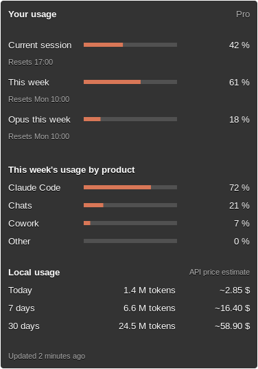

# Usage Monitor for Claude (xfce4-claude-usage-plugin)

An Xfce panel plugin that shows your Claude subscription usage at a glance.

- **Panel:** two Claude-orange bars for the 5-hour session and the weekly limit.
- **Tooltip:** every limit reported by Claude, with its reset time, the week's usage per
  product, and your local Claude Code token consumption with an estimated API-price cost.



## How it works

- **Subscription usage:** read from the same endpoint Claude Code's `/usage` uses,
  authenticated with the OAuth token in `~/.claude/.credentials.json`. The plugin never
  refreshes that token. If it has expired, run `claude` once and the plugin picks up the
  new one.
- **Local consumption:** computed from Claude Code's session logs in
  `~/.claude/projects/**/*.jsonl`, read incrementally in a background thread.

The usage endpoint is undocumented and may change. The parser tolerates unknown or
missing fields and falls back to the older `five_hour`/`seven_day` fields, but expect
breakage if the API changes drastically.

Costs are estimates at public API prices. They are not what a subscription bills you.

### Terms of use

Anthropic says subscription OAuth credentials are meant for Claude Code and Anthropic's
own apps ([Claude Code legal and compliance](https://code.claude.com/docs/en/legal-and-compliance#authentication-and-credential-use)).
This plugin only reads your own token locally and makes the same read-only usage request as
Claude Code's `/usage`. It sends no prompts, uses no inference, and passes nothing to third
parties. Still, it is an unofficial tool using those credentials: Anthropic could block it,
and using it is your decision.

## Requirements

- Xfce panel 4.16+ (developed on 4.20)
- GTK 3, libxfce4panel-2.0, libxfce4ui-2, libxfce4util-1.0
- libsoup 3, json-glib 1.x
- meson, ninja, gettext

On Debian/Ubuntu (package names checked on Ubuntu 24.04):

```sh
sudo apt install meson ninja-build gettext libgtk-3-dev libxfce4panel-2.0-dev \
  libxfce4ui-2-dev libxfce4util-dev libsoup-3.0-dev libjson-glib-dev
```

## Build and install

The plugin must be installed in the same prefix as `xfce4-panel`, usually `/usr`:

```sh
meson setup build --prefix=/usr          # add --libdir=lib64 on Gentoo/Fedora-style layouts
ninja -C build
meson test -C build
sudo meson install -C build
xfce4-panel -r
```

Then right-click the panel and choose **Panel → Add New Items → Usage Monitor for Claude**.

To uninstall, keep the `build/` directory and run `sudo ninja -C build uninstall`.

> **Multilib systems:** if linking fails with "file in wrong format", point pkg-config at
> the 64-bit libraries, for example
> `PKG_CONFIG_PATH=/usr/lib64/pkgconfig:/usr/share/pkgconfig meson setup ...`, and keep
> it set for later `ninja` and `sudo -E meson install` runs.

## Usage

- **Left click:** opens claude.ai by default. You can change it to open Claude Desktop or
  run a custom command.
- **Middle click:** refreshes now.
- **Right click → Properties:** sets the refresh interval, bar width and height (0 =
  automatic), whether percentages, labels and time left before reset are shown, and the
  left-click action.

## Translations

The plugin follows the system language. It ships English, French and Spanish. To add a
language, using German as an example:

```sh
echo de >> po/LINGUAS
ninja -C build xfce4-claude-usage-plugin-update-po   # creates po/de.po
# translate po/de.po, then rebuild
```

To try a language without changing your session, run `xfce4-panel -q; LANGUAGE=de xfce4-panel`.
Restart the panel normally afterwards, because the panel and its plugins keep the
environment they were started with.

## License

GPL-2.0-or-later, like most Xfce components. See [COPYING](COPYING).

This is an unofficial project, not affiliated with or endorsed by Anthropic.
